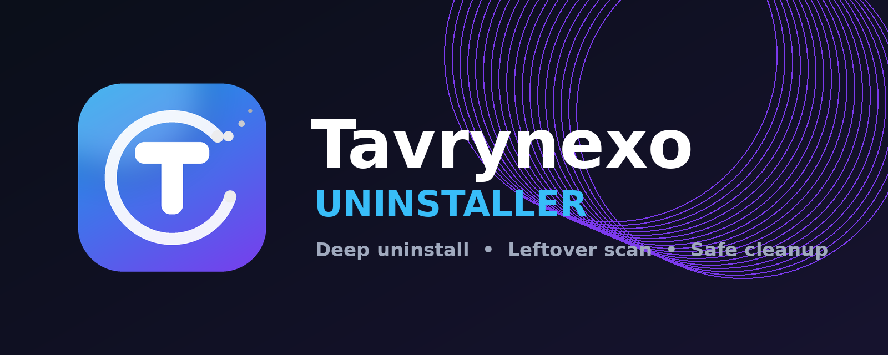

<p align="center"></p>

# Tavrynexo Uninstaller

Native Windows 10 / 11 desktop uninstaller (C# · WPF · .NET 8). Removes programs completely: runs the original uninstaller, then finds and removes leftover files, folders, registry keys, services and scheduled tasks.

مُزيل برامج أصلي لويندوز 10 و11 (C# · WPF · .NET 8). يشغّل المُزيل الأصلي ثم يبحث عن البقايا ويحذفها بدقة وأمان.

## Features

| | |
|---|---|
| **Programs** | Reads HKLM/HKCU Uninstall keys (64 + 32-bit), icons, sizes, search, sort, multi-select batch uninstall |
| **Deep leftover scan** | Program Files, ProgramData, AppData (Local/Roaming/LocalLow), Start Menu & Desktop shortcuts, registry (`Software\Vendor\Product`), App Paths, Run keys, services and scheduled tasks that point into the install folder |
| **Force remove** | For broken / half-removed programs with no working uninstaller |
| **Store apps** | Lists and removes Microsoft Store (AppX) apps |
| **Startup manager** | Enable / disable / delete startup entries (Run keys + Startup folders) |
| **Junk cleaner** | Temp, WER reports, Chrome/Edge/Firefox cache, DirectX shader cache, Recycle Bin |
| **Languages** | Arabic (RTL) and English |

## Safety design

- Restore point is created before uninstalling (can be turned off in Settings).
- Registry keys are exported to `.reg` files (`%LocalAppData%\Tavrynexo\Backups`) before deletion; if the backup fails the key is **not** deleted.
- Every leftover is shown to you first. **High-confidence** items are pre-selected; **Medium** ones are not.
- Protected locations (Windows, Program Files root, user profile, Documents, Common Files, vendor roots like `Microsoft`, `Google`, `Adobe`...) can never be matched or deleted. Checks run again at delete time.
- Leftover scan is skipped if the program is still registered after uninstalling (cancelled uninstall can't cause data loss).
- Folders/keys shared with another installed program (e.g. two versions side by side) are skipped.
- Locked files are scheduled for deletion at next reboot.
- Documents / Desktop user files are never scanned.

## Build the EXE with GitHub Actions

1. Create a new GitHub repository and upload everything from this folder (keep `.github/workflows/build.yml`).
2. Open the **Actions** tab → *Build Tavrynexo Uninstaller* runs automatically on push (or press **Run workflow**).
3. When it finishes, open the run → **Artifacts** → download `TavrynexoUninstaller-win-x64` (contains `TavrynexoUninstaller.exe`).
4. For a public download page, create a tag: `git tag v1.0.0 && git push origin v1.0.0` — the EXE is attached automatically to a GitHub Release.

The EXE is **self-contained, single-file** (no .NET installation needed) and asks for administrator rights on launch (required for HKLM, services and scheduled tasks).

## Build locally

```powershell
dotnet publish src/TavrynexoUninstaller/TavrynexoUninstaller.csproj -c Release -r win-x64 --self-contained true -p:PublishSingleFile=true -o publish
```

## Project layout

```
src/TavrynexoUninstaller/
  Core/       localization, settings, Safety rules, registry & process helpers
  Models/     InstalledProgram, LeftoverItem, StartupEntry, JunkCategory
  Services/   ProgramScanner, UninstallService, LeftoverScanner, CleanupService,
              StoreAppService, StartupService, JunkService, RestorePointService
  Views/      MainWindow, LeftoverWindow
  Assets/     icon.ico, logo.png
```

> Test first inside a VM or with a restore point on a non-critical program. Deleting is permanent for files and folders.
